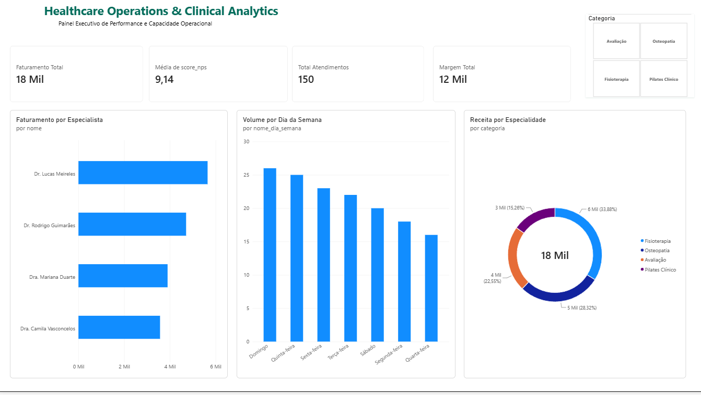
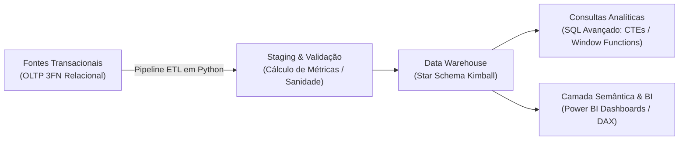
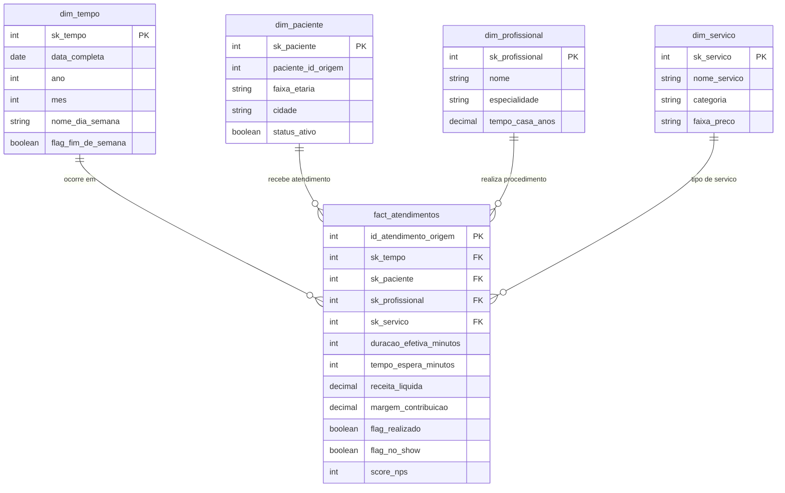

# Healthcare Operations & Clinical Data Warehouse



> **Solução de BI & Dashboard Power BI:** Arquivo completo para download disponível em [`Healthcare_Analytics.pbix`](Healthcare_Analytics.pbix) | Guia de medidas DAX em [`docs/dax_measures.md`](docs/dax_measures.md)

---

## Visão Executiva & Desafio de Negócio

Em instituições de saúde e clínicas especializadas (reabilitação, fisioterapia e pilates clínico), a tomada de decisão frequentemente sofre com a **fragmentação de prontuários e transações operacionais**. Dados transacionais (OLTP) sem modelagem analítica resultam em:
* Desconhecimento da taxa real de ociosidade das salas e horários de pico.
* Impacto financeiro silencioso provocado por taxas de *No-Show* (faltas sem aviso prévio).
* Falta de clareza sobre a margem de contribuição líquida por profissional e procedimento.
* Dificuldade em identificar precocemente o risco de evasão (*churn*) de pacientes em tratamento contínuo.

Este projeto implementou uma solução *end-to-end* de Engenharia de Dados e Business Intelligence: desde a normalização e extração de bancos transacionais relacionais até a modelagem dimensional (*Star Schema* de Ralph Kimball) e testes automatizados de qualidade de dados.

---

## Arquitetura da Solução



---

## Modelo Dimensional (Star Schema)

O modelo dimensional foi desenhado com granularidade no nível de **atendimento individual**, permitindo cruzamento multidimensional por tempo, paciente, profissional e serviço:



---

## Consultas Analíticas Avançadas (SQL)

O repositório disponibiliza queries em [`sql/03_analytical_queries.sql`](sql/03_analytical_queries.sql) que respondem perguntas estratégicas de gestão:
1. **Ocupação e Horários Críticos:** Utiliza funções de ranqueamento de janela (`RANK() OVER(PARTITION BY ...)`) e agregações de no-show para planejamento de escala.
2. **Margem de Contribuição Comparativa:** Compara o desempenho individual de cada profissional contra a média histórica da clínica calculada dinamicamente via Window Functions (`AVG(...) OVER()`).
3. **Cohort e Análise de Recência:** Identifica tempo médio entre sessões usando `LAG()` para mapear o risco de abandono de tratamentos fisioterápicos.

---

## Camada de Visualização & Business Intelligence (Power BI)

O repositório disponibiliza a solução completa de BI conectada diretamente ao Data Warehouse:
* **Arquivo do Dashboard:** [`Healthcare_Analytics.pbix`](Healthcare_Analytics.pbix) pronto para abertura e exploração no Power BI Desktop.
* **Documentação de DAX:** Medidas de negócio (KPIs, margem líquida, taxa de no-show e ranking) documentadas em [`docs/dax_measures.md`](docs/dax_measures.md).
* **Bases de Dados Modeladas:** Dados em Star Schema preparados para importação em [`data/powerbi/`](data/powerbi/).
* **Link powerBI:** https://app.powerbi.com/groups/me/reports/e569d434-0240-436b-83c3-93bb1fafbf65/fcb2eddd591c349e4cd2?experience=power-bi

---

## Qualidade e Confiabilidade de Dados (Data Quality CI/CD)

Seguindo os mais altos padrões de Engenharia de Dados, o pipeline conta com uma suíte de testes automatizados com `pytest` em [`tests/test_data_quality.py`](tests/test_data_quality.py):
* **Unicidade de Chaves:** Garante integridade de 100% nas chaves substitutas (*Surrogate Keys*).
* **Integridade Referencial:** Impede a inserção de registros órfãos na tabela Fato.
* **Aritmética de Métricas:** Validação matemática estrita de margens e descontos.
* **Exclusividade Mútua de Flags:** Impede que um atendimento seja faturado e cancelado simultaneamente.

---

## Como Reproduzir Localmente

```bash
# 1. Clone o repositório
git clone https://github.com/luannagyo/-clinical-data-warehouse.git
cd -clinical-data-warehouse

# 2. Instale as dependências
pip install -r requirements.txt

# 3. Execução completa com demonstração de relatórios (Recomendado)
python scripts/run_showcase.py

# Ou execute as etapas individualmente:
# Pipeline de ETL
python scripts/etl_pipeline.py

# Suíte de testes de qualidade de dados (Data Quality)
python tests/test_data_quality.py
```

---

## Autora
**Luanna Oliveira**  
*Graduanda em Sistemas de Informação (PUC Minas) | Bacharel em Biomedicina*  
* [LinkedIn](https://www.linkedin.com/in/luannagyovana/)
* [GitHub](https://github.com/luannagyo)
